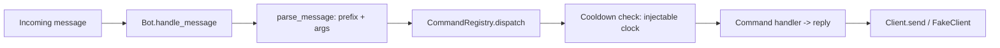

<p align="center">
  
</p>

<h1 align="center">Discord Bot Template</h1>

<p align="center">
  <strong>A transport-agnostic Discord-style bot framework — command parsing, a registry with cooldowns, and a fake gateway — in Python.</strong><br>
  Register commands, parse messages with a configurable prefix, and test everything offline with no token and no SDK.
</p>

<p align="center">
  <em>Built and maintained by <a href="https://viprasol.com">Viprasol Tech</a> — Fintech Experts. Full-Stack Builders.</em>
</p>

<p align="center">
  <a href="https://github.com/Viprasol-Tech/discord-bot-template/actions/workflows/ci.yml"></a>
  <a href="LICENSE"></a>
  
  <a href="https://t.me/viprasol_help"></a>
  <a href="https://github.com/Viprasol-Tech/discord-bot-template/stargazers"></a>
</p>

---

> ### Offline by design — no token, no SDK
> The transport is a tiny `Client` protocol (`send(channel, content)`). The library ships a `FakeClient` that records messages in memory, so the demo and the entire test suite run with **no network, no Discord token, and no `discord.py` dependency**. Swap in a real gateway by implementing `send` — the parsing, routing, cooldown, and rate-limiting logic stays exactly the same.

---

## Features

- **Prefix parsing** — turn `"!ping arg1 arg2"` into a `(command, args)` invocation with a configurable prefix; non-prefixed messages are ignored. Shell-style quoting (`!say "hello world"`) is supported.
- **Command registry** — register handlers by name (or via a `@registry.command(...)` decorator) and `dispatch(message)` to a typed reply.
- **Per-command cooldowns** — rate-limit any command with an **injectable clock**, so cooldowns are fully deterministic in tests.
- **Pluggable transport** — a `Client` protocol plus an in-memory `FakeClient`; bring your own gateway for production.
- **Friendly errors** — unknown commands and cooldown hits become user-facing replies instead of crashes.
- **CLI demo** — `discord-bot-template demo` runs a scripted offline conversation.
- **Modern tooling** — ruff, mypy (strict), pytest, GitHub Actions CI.

## Quickstart

```bash
git clone https://github.com/Viprasol-Tech/discord-bot-template.git
cd discord-bot-template
python -m pip install -e ".[dev]"

# Run a scripted offline conversation through the bot:
discord-bot-template demo
discord-bot-template demo --prefix /
```

## Write your own bot

```python
from discord_bot_template.bot import Bot
from discord_bot_template.client import FakeClient
from discord_bot_template.registry import CommandRegistry, Context

registry = CommandRegistry(prefix="!")


@registry.command("ping", cooldown=3.0, help="Health check.")
def ping(ctx: Context) -> str:
    return "pong"


bot = Bot(registry, FakeClient(), channel="general")
print(bot.handle_message("!ping", author="alice"))  # -> "pong"
print(bot.handle_message("!ping", author="alice"))  # -> "Slow down! Try 'ping' again in 3.0s."
```

To go live, replace `FakeClient` with any object that implements
`send(channel: str, content: str) -> None`.

## Architecture



## Roadmap

- [x] Prefix parsing, registry, dispatch, per-command cooldowns
- [x] `Client` protocol + `FakeClient` transport
- [x] CLI demo + strict typing + tests
- [ ] Async dispatch and concurrent handlers
- [ ] Slash-command / interaction style parsing
- [ ] Permission checks and middleware hooks
- [ ] Reference adapter for a real gateway

## Contributing

PRs welcome — see [CONTRIBUTING.md](CONTRIBUTING.md) and our [Code of Conduct](CODE_OF_CONDUCT.md).

## 📬 Contact — Viprasol Tech Private Limited

- 🌐 Website: [viprasol.com](https://viprasol.com)
- ✉️ Email: [support@viprasol.com](mailto:support@viprasol.com)
- 💬 Telegram: [t.me/viprasol_help](https://t.me/viprasol_help) · 📱 WhatsApp: +91 96336 52112
- 🐙 GitHub: [@Viprasol-Tech](https://github.com/Viprasol-Tech) · 💼 [LinkedIn](https://www.linkedin.com/in/viprasol/) · 𝕏 [@viprasol](https://twitter.com/viprasol)

> *Viprasol Tech — fintech software, algorithmic trading systems, MT4/MT5 bots, AI voice agents, and B2B SaaS. Need a custom build? [Get in touch](mailto:support@viprasol.com).*

## License

[MIT](LICENSE) (c) 2025 Viprasol Tech Private Limited
